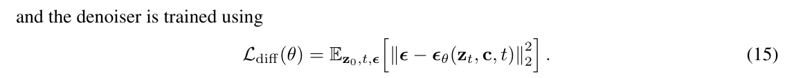
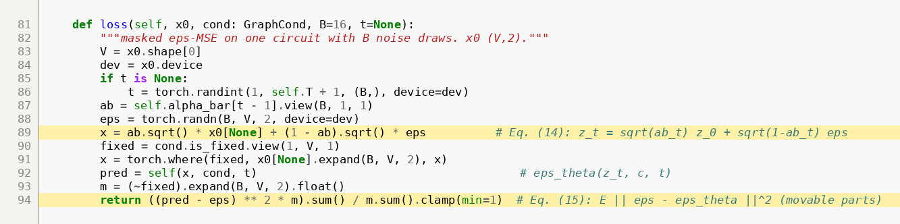
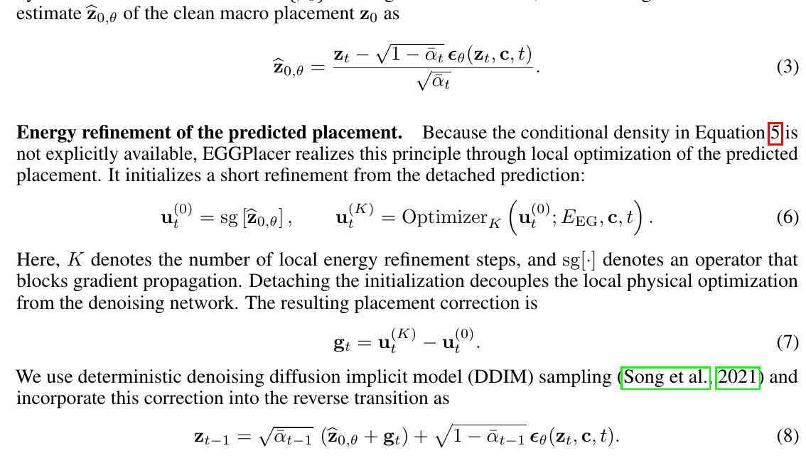
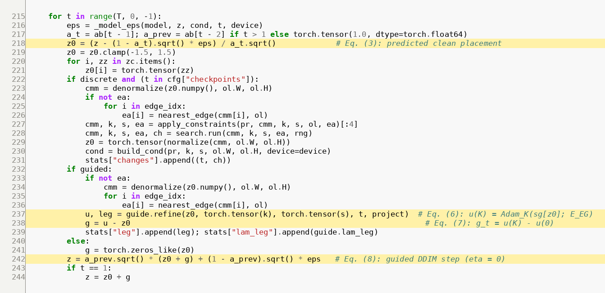
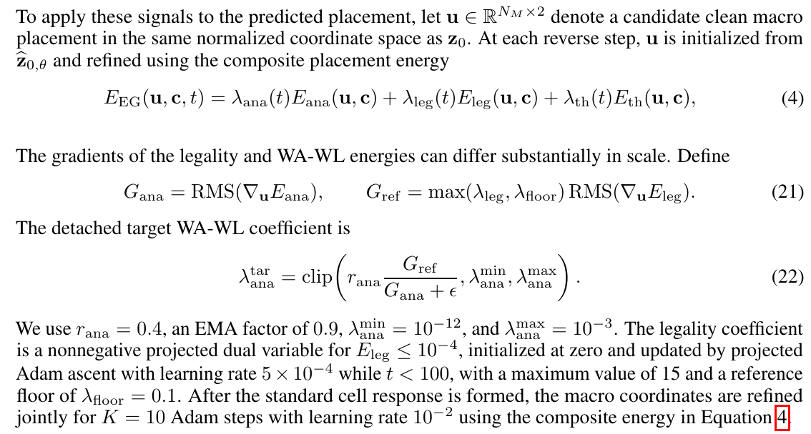
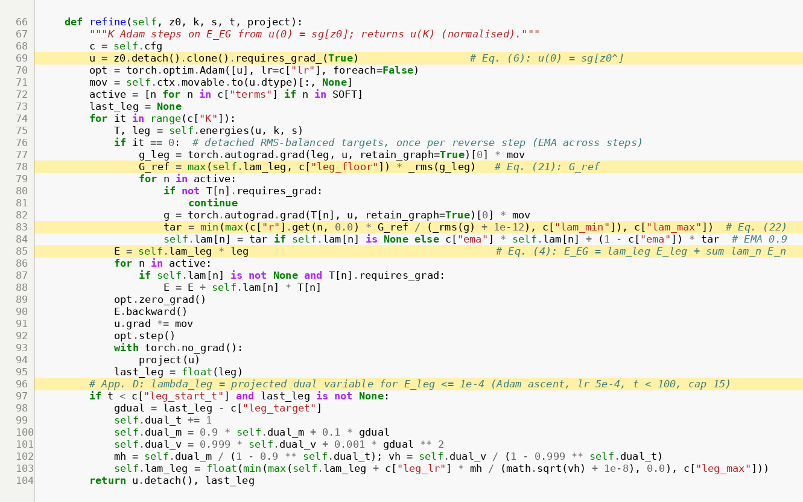
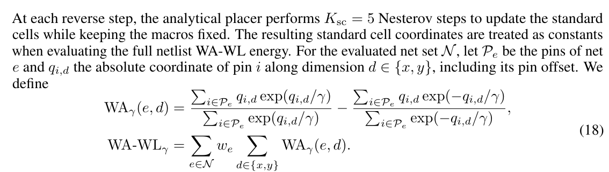
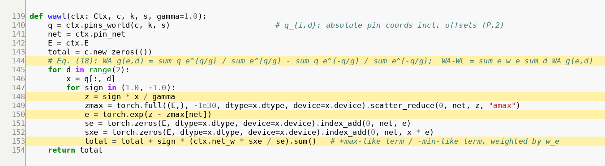
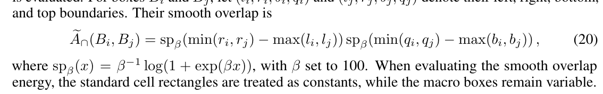
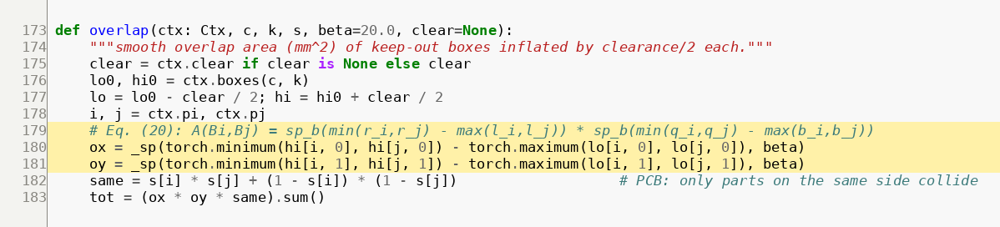

# EGGPlacer for PCBs

Energy-guided diffusion placement for printed circuit boards: a PCB adaptation of

> **EGGPlacer: Energy-Guided Generative Chip Placement with Diffusion Models**
> Qi Zhou, Guojun Liu, Juanhong Zhao, Guangzhi Qi, Zehao Chen, Ming Lu. arXiv:2610.33099, Oct 2026.
> [arxiv.org/abs/2610.33099](https://arxiv.org/abs/2610.33099)

The paper places chip macros with a conditional diffusion model and, at every reverse step, nudges
the model's predicted placement with a few gradient steps on physical energies (wirelength,
legality, thermal) before substituting it back into the DDIM update. This repository applies the
same idea to KiCad boards:
- every footprint is a "macro";
- the energies are PCB energies: pad-level wirelength, courtyard overlap, outline containment,
  decoupling distance, sheet grouping, compactness;
- an outer search shrinks the board outline until Freerouting can no longer route it 100% with
  zero DRC errors.

The denoiser backbone and training setup follow **ChipDiffusion** (Lee et al., *Chip Placement with
Diffusion Models*, [arXiv:2407.12282](https://arxiv.org/abs/2407.12282),
[github.com/vint-1/chipdiffusion](https://github.com/vint-1/chipdiffusion)).

There is no official EGGPlacer code. This is an independent implementation from the paper text.

> **Status: research code.**
> - Verified on a 241-part, 2-layer test board: energies, SA baseline, legalizer, KiCad round trip,
>   synthetic data, training on one L4 GPU, and guided sampling.
> - The outer size search is written but not yet validated end to end.
> - On the test board, Freerouting doesn't reach 100% completion yet, which is the binding
>   constraint (see [GUIDE.md](GUIDE.md#known-limits-from-our-test-board)).
> - No pretrained checkpoint is published; train one for your board (GUIDE steps 9–10).

---

## Quick start

```bash
git clone https://github.com/aPR0T0/eggplacer && cd eggplacer
python3 -m venv --system-site-packages .venv && source .venv/bin/activate   # system site: KiCad's pcbnew
pip install --index-url https://download.pytorch.org/whl/cpu torch          # or a CUDA build to train
pip install -r requirements.txt
bash scripts/fetch_chipdiffusion.sh      # backbone, fetched from upstream (it has no licence to redistribute)

python tests/test_energy.py              # energies: torch == numba, gradients vs finite differences
python scripts/demo.py                   # no KiCad needed: synthetic circuit -> SA placement -> PNGs in out/demo
python scripts/demo.py --ckpt ema_latest.pt   # + unguided and energy-guided diffusion with a trained model
```

To place your own KiCad board (copy the project, write a rules config, parse, check footprints,
SA baseline, synthetic data, training on GCP, guided sampling, size search), follow
**[GUIDE.md](GUIDE.md)**. It has the exact commands for every step.

---

## From the paper to the code

Each pair shows the equation as printed in the paper and the code that implements it. Highlighted
lines carry an `# Eq. (n)` comment in the source, and the line numbers are the real ones.
Regenerate the figures with `python docs/make_figures.py`.

### 1. Training objective (App. C, Eq. 15)
The denoiser learns to predict the noise added to a clean placement, with the loss counted on
movable parts only.



[`eggpcb/model.py#L81-L94`](eggpcb/model.py#L81-L94)

### 2. Energy-guided reverse step (Sec. 3.1, Eq. 3, 6, 7, 8)
1. Predict the clean placement ẑ₀ (Eq. 3).
2. Refine a detached copy with K Adam steps on the energy (Eq. 6).
3. Take the displacement g (Eq. 7).
4. Put ẑ₀ + g back into the deterministic DDIM update (Eq. 8).

The diffusion model stays frozen. Hard PCB constraints (corner holes, edge connectors) are
projections applied inside the refinement.



[`eggpcb/sample.py#L215-L244`](eggpcb/sample.py#L215-L244)

### 3. Composite energy and adaptive weighting (Eq. 4, App. D Eq. 21–22)
Every soft term (wirelength, density, compactness, decoupling, grouping) gets its own
RMS-gradient-balanced coefficient, referenced to the legality gradient (Eq. 21–22). The legality
weight is a projected dual variable for E_leg ≤ 1e-4.



[`eggpcb/sample.py#L66-L104`](eggpcb/sample.py#L66-L104)

### 4. Weighted-average wirelength (App. D, Eq. 18)
Pin coordinates include each pad's offset after the part's rotation and side mirroring. The
log-sum-exp is stabilised per net with a scatter-max.



[`eggpcb/energies.py#L139-L154`](eggpcb/energies.py#L139-L154)

### 5. Smooth rectangle overlap (App. D, Eq. 20)
Softplus overlap between keep-out boxes, inflated by the courtyard clearance. On a two-sided board
it's weighted by the probability that both parts are on the same side.



[`eggpcb/energies.py#L173-L183`](eggpcb/energies.py#L173-L183)

What changed for PCBs, and why, is in **[docs/DESIGN.md](docs/DESIGN.md)**: no standard cells,
rotation and side search, edge connectors, routing, and synthetic data.

---

## Repository layout

```
eggpcb/          library
  kicad_io.py    .kicad_pcb -> Problem (keep-out boxes, pads, nets), KiCad frame conventions
  rules.py       board rules from configs/*.json (fixed / edge / corner parts, sides, net weights)
  energies.py    differentiable PCB energies + exact legality check
  sa.py          simulated-annealing baseline on the identical energy (numba)
  legalize.py    greedy grid legalizer (largest first, nearest feasible point)
  model.py       ChipDiffusion AttGNN denoiser, cosine schedule, EMA
  sample.py      energy-guided DDIM sampling with adaptive weights
  synth.py       synthetic circuits matched to a target board; datagen.py builds training records
  train.py       resumable training (GCS-mirrored checkpoints)
  board_out.py   write a placement + rounded outline to a NEW .kicad_pcb, pad check, DRC
  route.py       DSN -> Freerouting (headless) -> SES -> zone refill -> DRC metrics
  size_search.py outer board-size bisection (written, not yet validated end to end)
scripts/         demo, board_stats, plot_footprints, run_sa, export_placement, eval_model, fetch_chipdiffusion.sh
configs/         example_board.json (every key explained in GUIDE.md), jlcpcb_2layer.kicad_dru
gcp/             VM launch / startup (idle watchdog, max run time) / cost ledger
dashboard/       live training dashboard (polls GCS): source gcp/env.sh && python dashboard/server.py
docs/            DESIGN.md, make_figures.py, img/
tests/           energy equality + gradient checks
```

## Requirements
- Python 3.10+, PyTorch, torch_geometric, numpy, scipy, numba, shapely, matplotlib (`requirements.txt`).
- For KiCad boards: KiCad 10 (`pcbnew` Python module and `kicad-cli`).
- For routing: Freerouting 1.9.0 (needs a display; a user-space Xvfb works) or 2.5.0 (needs Java 25).
- For training at scale: Google Cloud (`gcloud`). One NVIDIA L4 is enough for this ~0.57M-parameter
  model.

## Citing
If you use this code, cite the original papers:

```bibtex
@article{zhou2026eggplacer,
  title   = {EGGPlacer: Energy-Guided Generative Chip Placement with Diffusion Models},
  author  = {Zhou, Qi and Liu, Guojun and Zhao, Juanhong and Qi, Guangzhi and Chen, Zehao and Lu, Ming},
  journal = {arXiv preprint arXiv:2610.33099},
  year    = {2026}
}
@article{lee2024chipdiffusion,
  title   = {Chip Placement with Diffusion Models},
  author  = {Lee, Vint and Nguyen, Minh and Elzeiny, Leena and Deng, Chun and Abbeel, Pieter and Wawrzynek, John},
  journal = {arXiv preprint arXiv:2407.12282},
  year    = {2024}
}
```

## Licence
- The code in this repository is MIT licensed (see [LICENSE](LICENSE)).
- The ChipDiffusion backbone is **not** included. `scripts/fetch_chipdiffusion.sh` downloads it from
  its upstream repository, which currently has no licence file; check its terms before
  redistributing anything built on it.
- The equation images in `docs/img/paper_*` are short excerpts of arXiv:2610.33099, reproduced with
  attribution for commentary. The paper is distributed under arXiv's non-exclusive licence, and
  copyright remains with its authors.
